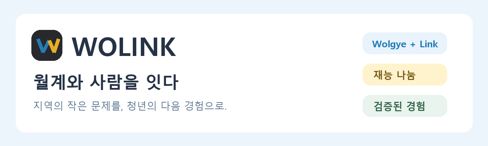
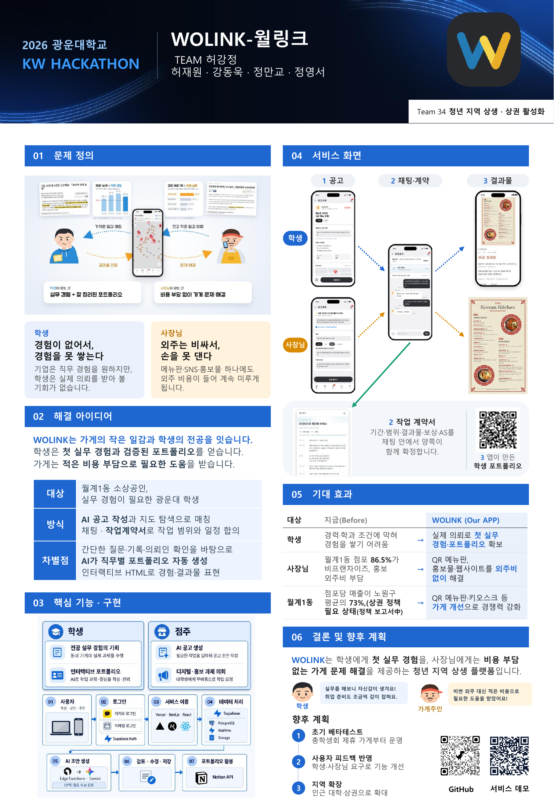
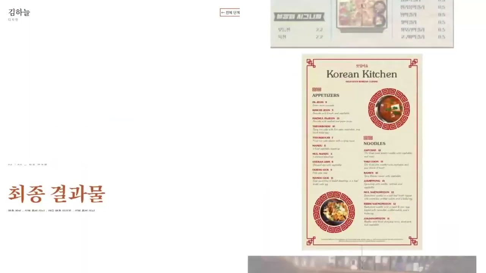
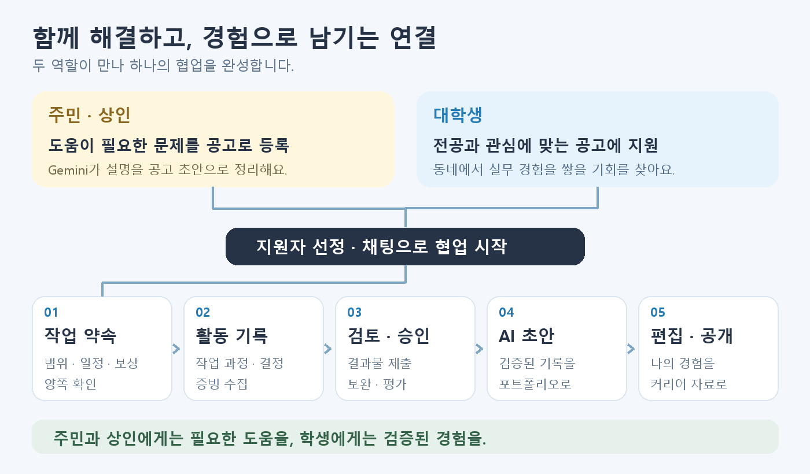
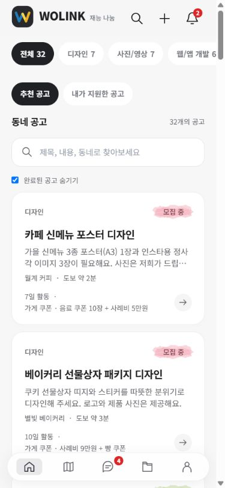
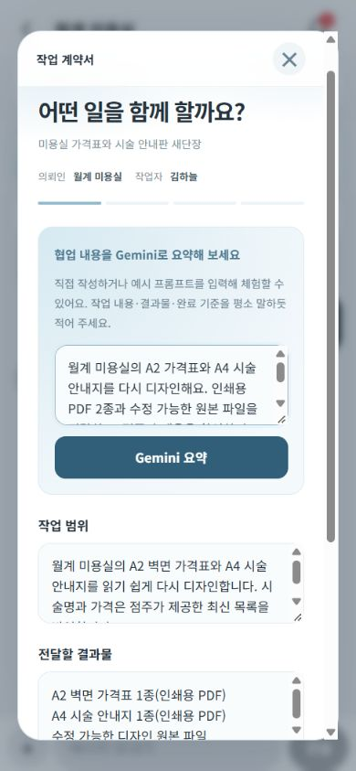
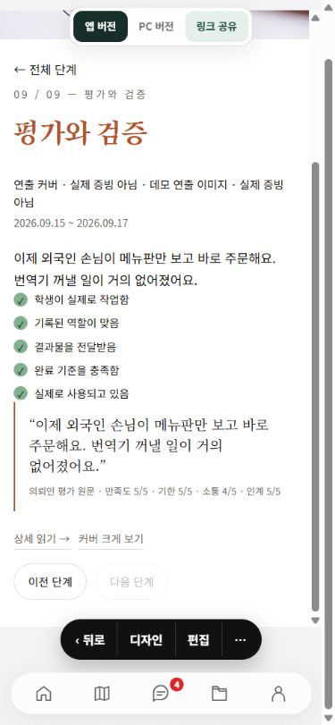

<div align="center">



**월계1동의 청년과 지역을 연결하는 재능 나눔 플랫폼**

전공으로 동네의 문제를 해결하고, 검증된 경험을 나의 포트폴리오로.

[](https://wolgye-talent.vercel.app/)
[](https://www.youtube.com/watch?v=UfXsSFIvuE8)
[](docs/guides/DEVELOPMENT.md)

**2026 광운대학교 해커톤 · 34팀 허강정**

</div>

---

## 월계에서 연결되고, 경험으로 남다

**WOLINK = Wolgye + Link.** 월계1동의 청년과 지역이 서로를 잇고 함께 성장한다는 뜻입니다.

대학생은 전공을 살린 재능기부로 실무 경험을 쌓고, 주민과 상인은 디지털 도움·디자인·홍보 등 생활과 가게 운영에 필요한 도움을 얻습니다. WOLINK는 공고와 매칭을 넘어, 협업 과정과 결과물을 기록하고 의뢰인의 확인을 거쳐 포트폴리오로 남깁니다.

> 봉사시간을 기록하는 데서 한 걸음 더. **문제를 해결한 경험을 기록합니다.**

| 🎓 대학생 | 🏪 주민 · 상인 |
| :--- | :--- |
| 전공과 관심에 맞는 지역 공고 찾기 | 가게와 생활의 고민을 공고로 등록하기 |
| 채팅으로 범위·일정·결과물 협의하기 | 지원자 프로필과 메시지 비교하기 |
| 실제 작업과 증빙을 기록하기 | 결과물을 검토하고 작업을 확인하기 |
| 검증된 경험을 AI 포트폴리오로 정리하기 | 지역 청년과 지속적인 관계 만들기 |

## 🖼 전시 포스터

광운대학교 해커톤 **34팀 허강정**의 WOLINK 전시 포스터입니다. 서비스의 문제 정의, 학생과 상인의 이용 흐름, 주요 화면과 기대 효과를 한 장에 담았습니다.

<div align="center">
  <a href="docs/assets/wolink-exhibition-poster.png"></a>
</div>

[포스터 원본 PDF 보기](docs/assets/wolink-exhibition-poster.pdf) · [포스터 이미지 크게 보기](docs/assets/wolink-exhibition-poster.png)

## 🎬 시연영상

**공고 등록 → 지원과 채팅 → AI 계약서 요약 → 경험 포트폴리오**를 영상으로 확인하세요.

[](https://www.youtube.com/watch?v=UfXsSFIvuE8)

▶ **[YouTube에서 시연영상 보기](https://www.youtube.com/watch?v=UfXsSFIvuE8)** · **[앱 직접 체험하기](https://wolgye-talent.vercel.app/)**

### 포트폴리오 양식 · 결과물 영상

활동 기록이 포트폴리오 페이지에서 어떻게 보이는지 영상으로 살펴볼 수 있습니다. 문제를 발견한 배경부터 해결 과정, 결과물과 의뢰인 평가까지 한 사례의 흐름을 담았습니다.

[](https://www.youtube.com/watch?v=rxauHCENt94)

▶ **[포트폴리오 양식 영상 보기](https://www.youtube.com/watch?v=rxauHCENt94)**

## 🔗 서비스 이용 흐름



1. **지역 문제를 등록해요.** 주민·상인이 필요한 도움을 적으면 Gemini가 공고 초안을 정리합니다.
2. **원하는 공고에 지원해요.** 학생은 분야·관심·거리를 참고해 공고를 찾고 지원합니다.
3. **채팅으로 협의해요.** 선정 후 작업 범위·결과물·완료 기준·일정·보상을 약속서에 담고 양쪽이 확인합니다.
4. **작업을 기록하고 검증받아요.** 과정과 증빙을 남기고 결과물을 제출하면 의뢰인이 보완 요청 또는 승인·평가합니다.
5. **나의 경험으로 남겨요.** AI가 기록을 포트폴리오 초안으로 구성하고, 학생이 편집해 공개하거나 공유합니다.

## 📱 실제 서비스 화면

<table>
<tr><th>동네 공고 탐색</th><th>AI 작업 약속서</th><th>포트폴리오 검증 기록</th></tr>
<tr>
<td align="center"></td>
<td align="center"></td>
<td align="center"></td>
</tr>
</table>

*데모 계정으로 촬영한 실제 앱 화면입니다. 작업 약속서와 포트폴리오는 서로 다른 예시 프로젝트입니다.*

## ✨ 주요 기능

| 기능 | WOLINK에서 할 수 있는 일 |
| :--- | :--- |
| 공고 피드 · 동네 지도 | 디자인, 사진/영상, 웹/앱 개발, SNS 콘텐츠, 디지털 도움 공고 탐색 |
| Gemini 공고 생성 | 일상적인 설명을 문제·결과물·완료 기준이 담긴 공고 초안으로 정리 |
| 지원 · 선정 · 채팅 | 지원자별 대화와 알림, 협업 당사자 연결 |
| 작업 약속서 | 협의 내용을 AI로 요약하고 일정 선택, 같은 버전을 양쪽이 확인 |
| 활동 기록 · 증빙 · 검토 | 분야별 질문, 결과물 제출, 보완 요청과 재제출, 의뢰인 확인·평가 |
| AI 포트폴리오 | 문제·결정·과정·결과·회고를 HTML 포트폴리오로 구성하고 편집 |
| 나의 작업실 | 프로필과 경험 피드, 분야별 완료 기록, 작업 공개 설정 |

### 가입 없이 체험하기

[서비스](https://wolgye-talent.vercel.app/)의 로그인 화면에서 **학생 또는 주민·상인 데모 계정**을 선택하세요. 안내를 따라 체험하거나 자유롭게 둘러볼 수 있습니다. `나` 화면에서 계정을 전환하며 양쪽의 경험을 확인할 수 있습니다.

데모 기록과 실제 이용 기록은 구분됩니다. 데모 데이터는 같은 브라우저 안에서 공유되며 다른 기기와 자동 동기화되지 않습니다.

## 🛠 기술 구성

| 영역 | 기술 |
| :--- | :--- |
| 웹 | Next.js 14 · React 18 · TypeScript · Tailwind CSS |
| 백엔드 | Supabase Auth · PostgreSQL · Realtime · Edge Functions |
| AI | Gemini — 공고·약속서 요약·포트폴리오 초안 |
| 지도 | Leaflet · OpenStreetMap · MapLibre |
| 모바일 | Capacitor 8 · Android |
| 검증 | Vitest · PGlite · Playwright · GitHub Actions |
| 배포 | Vercel — 정적 웹 / Supabase — 서버 기능 |

## 🚀 로컬 실행

Node.js **22 LTS**를 권장합니다. 프로젝트 루트에서 실행하세요.

```bash
npm ci
# .env.example을 .env.local로 복사한 뒤 데모 모드 설정
npm run dev
```

`.env.local`에서 `NEXT_PUBLIC_DEMO_MODE=true`로 설정하면 데모 모드로 실행됩니다. 실제 인증·DB·AI 연결은 [개발 가이드](docs/guides/DEVELOPMENT.md)와 [Supabase 설정](docs/guides/SUPABASE.md)을 확인하세요.

| 명령 | 용도 |
| :--- | :--- |
| `npm run dev` | 로컬 개발 · `http://localhost:3000` |
| `npm run build` | 정적 웹 빌드 · `out/` 생성 |
| `npm run preview` | 빌드 결과 확인 · `http://localhost:3002` |
| `npm run typecheck` / `npm run lint` | 타입 · 코드 검사 |
| `npm test` | 단위 테스트 · DB/RLS 검사 |
| `npm run android:sync` | 웹 빌드 후 Android 프로젝트에 복사 |

## 📁 폴더 안내

```text
.
├── src/                 웹 앱 소스
│   ├── app/             화면과 라우트
│   ├── components/      공통 UI · 튜토리얼 · 작업 약속서
│   ├── lib/             데이터 접근 · 세션 · AI · 협업 규칙
│   ├── templates/       HTML 포트폴리오 템플릿
│   └── types/           도메인 타입
├── public/              브랜드 · 이미지 · 글꼴 · 소개 영상
├── supabase/            DB 마이그레이션 · Edge Functions
├── android/             Capacitor Android 프로젝트
├── tests/               단위 테스트 · DB 검증
├── e2e/                 브라우저 시나리오 검증
├── scripts/             미리보기 · 계정/데이터 관리 도구
├── prototype/           독립 UI 실험과 참고 구현
├── docs/
│   ├── assets/          README 이미지 · 서비스 흐름도
│   ├── guides/          실행 · 배포 · 외부 연동 · 데모 안내
│   ├── design/          설계와 평가 정책
│   └── archive/         이전 README · 통합 검증 기록
└── .github/             PR 양식 · Android 빌드 워크플로
```

**[전체 문서 목록](docs/README.md)** · [기여 안내](CONTRIBUTING.md) · [외부 리소스 출처](THIRD_PARTY_NOTICES.md)

| 먼저 찾을 문서 | 내용 |
| :--- | :--- |
| [개발 가이드](docs/guides/DEVELOPMENT.md) | 환경변수, 실행, 검사, Android 빌드 |
| [Supabase · Gemini](docs/guides/SUPABASE.md) | DB와 AI 서버 연결 |
| [Vercel 배포](docs/guides/VERCEL.md) | 운영 브랜치와 배포 설정 |
| [팀 프로젝트 데모](docs/guides/TEAM_PROJECT_DEMO.md) | 여러 역할의 협업 시나리오 |
| [서비스 설계](docs/design/ARCHITECTURE.md) | 데이터 접근 구조와 협업 파이프라인 |
| [Notion 연동](docs/guides/NOTION.md) | 선택 기능인 외부 내보내기 설정과 복구 |

### 구현 범위

Notion 내보내기는 외부 연동 설정이 필요하며 실제 Notion 계정 검증은 별도입니다. 팀 단체 채팅과 모바일 푸시는 아직 제공하지 않습니다. Vercel 웹 배포와 DB 마이그레이션·Edge Function 배포는 별도 단계입니다.

---

<div align="center">

**지역의 작은 문제를, 청년의 다음 경험으로.**

WOLINK · 월계와 사람을 잇다

[MIT License](LICENSE)

</div>
